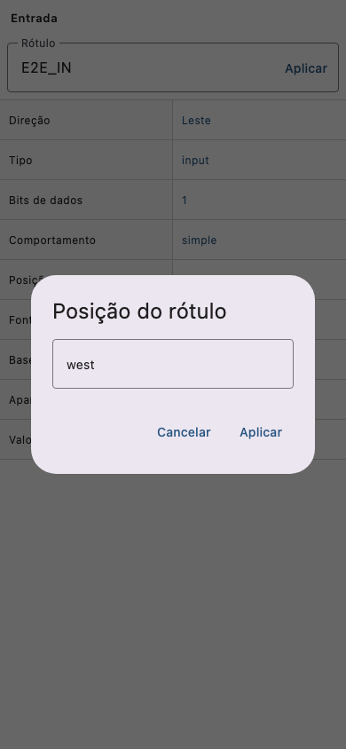
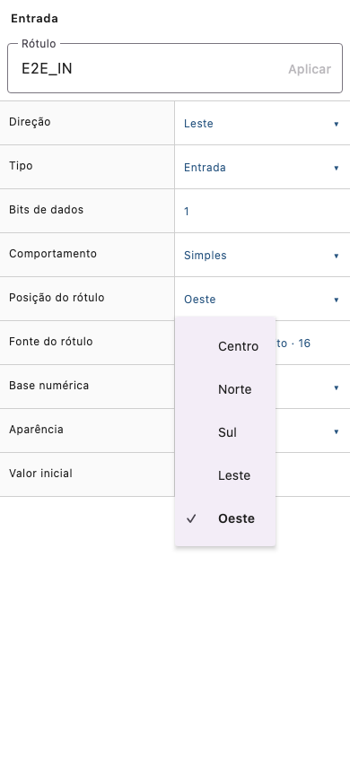
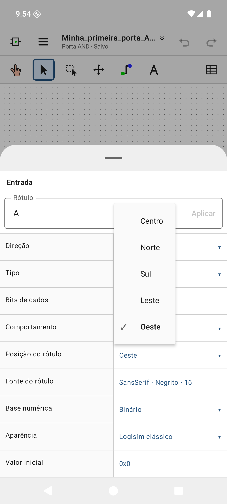
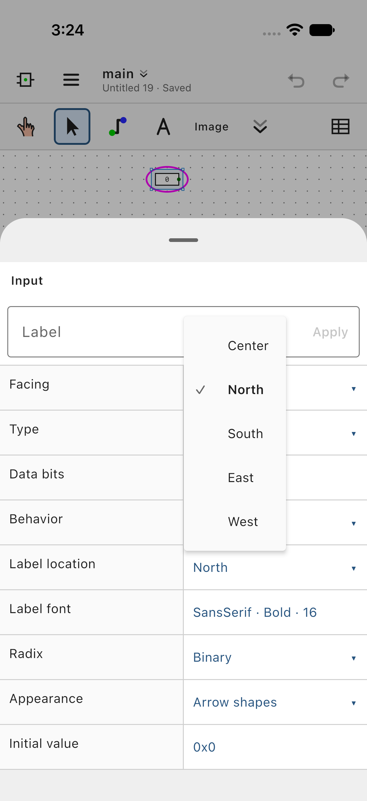

# UI/UX sweep of the mobile editor

- Mobile base: `579903649641cdc90ed6df95b7af8b3ab75287cb` (pre-sweep). The sweep's code is in commits `86cb33ec`..`83cd1d79` on branch `ui-ux-sweep`; this record is the next commit. The tests ran on tree `1f11169bc718a1d55e3bc5ce2d74a6d948f30cc5`, which those commits reproduce. The parity rows still need their evidence re-run on that SHA.
- Evolution reference: `d58a61e0`.
- Environment: macOS 27.2.1 arm64 (Apple M5 Max, 48 GB), OpenJDK 25.0.4 (Android Studio JBR), Gradle 9.6.1, Xcode 27.2.
  - iOS Simulator: iPhone 17, iOS 27.2.
  - Android emulator `Logisim_E2E_API_36`: Android 16, API 36, Pixel 8 profile.
  - TalkBack: `Medium_Phone_API_37.0` (API 37, TalkBack 17.0).

## Trigger and scope

The maintainer reported that changing a component's label direction meant deleting `north` and typing `west` in a text field, and asked for a full sweep of the app that fixes such flaws, with proof.

The sweep ran in four steps:
1. An audit of every screen produced 163 findings, all confirmed by an independent adversarial verifier, plus 10 extra findings (X0–X9). By severity: {'critical': 1, 'high': 46, 'medium': 91, 'low': 35}.
2. Fixes were made in isolated packages, each with host tests and before/after screenshots and an adversarial review:
   - wave 1: 12 packages (inspector, workspace safety, pickers, canvas gestures, touch tools, simulation controls, memory editor, FPGA, analysis, tool panels);
   - wave 2: 10 packages;
   - wave 3: 5 packages;
   - a final round.
3. A skeptical verifier checked every finding against the integrated code.
4. Device runs.

Every user-visible string goes through the message catalog, and all 13 published locales are complete: 4254 keys, `generate-localization.py --check` passes. The `.circ` format is unchanged: options are still stored as `north`, `west`, and so on.

## Proof of the reported flaw

| Before | After (host, Skia) | Android app | iOS app |
| --- | --- | --- | --- |
|  |  |  |  |

What each column shows:
- **Host:** `InspectorOptionEditorsHostTest.labelLocationIsChosenFromAMenuAndAppliedAsOneUndoableEdit` opens a menu of Evolution's display names with the current value marked. One tap applies the choice as one undoable edit and writes `<a name="labelloc" val="north"/>`.
- **Android:** the debug APK on emulator-5554. Pin A is selected, Properties is open and the Label location menu shows Oeste marked. Choosing Norte moves the label above the pin: `mobile/android-labelloc-north.png`.
- **iOS:** the new XCUITest `InspectorEndToEndTests.testLabelLocationIsChosenFromAMenu` gives NATIVE_PASS on the iPhone 17 simulator.
  - The menu offers Center, North, South, East and West, with exactly the current value Selected.
  - Choosing another value updates the row's accessibility value, for example "Label location, West".
  - The project XML stores the serialized value.
  - Screenshots: `mobile/ios-labelloc-menu.png` and `mobile/ios-labelloc-west.png`.

## Final gate (final tree)

```
./gradlew :core:jvmTest :composeApp:testAndroidHostTest :composeApp:jvmTest \
  :composeApp:compileTestKotlinIosSimulatorArm64 :androidApp:compileDebugAndroidTestKotlin \
  --continue --rerun-tasks -Pkotlin.incremental=false -PuiScreenshots=outputs/ui-ux-sweep/final
python3 scripts/generate-localization.py --check
python3 scripts/test-localization.py
python3 scripts/check-source.py
python3 -B -m unittest discover -s scripts -p 'test_*.py'
python3 -B -m unittest discover -s scripts/tests -p 'test_*.py'
python3 -B -m unittest discover -s tools/tests -p 'test_*.py'
```

| Suite | Result |
| --- | --- |
| core `jvmTest` | 1444 tests, 0 failures, 11 skipped |
| composeApp commonTest (`testAndroidHostTest`) | 1198 tests, 0 failures |
| composeApp host UI (`jvmTest`, Skia renderer as on iOS) | 437 tests, 0 failures, 858 screenshots |
| iOS and androidTest compilation | pass |
| Localization (strict generator, `test-localization.py`), `check-source.py`, `tools/tests` | pass |
| `scripts` unit tests | 541 run, 1 error: the PDF decoder needs poppler. This also fails on the base. |
| `scripts/tests` | Same failures as the base (host-environment and CI-routing tests), except `test_parity_matrix.test_generated_files_are_current`. That test passes after `python3 scripts/parity_matrix.py` regenerated `docs/parity.*`. |

`docs/parity.md` now reports **Needs recheck = 101**: the sweep changed files watched by those rows' existing evidence. Those campaigns must be re-run on the committed SHA. This is the project's normal re-verification step, not a known regression.

## Device runs

Android (emulator-5554):
- **Manual flow:** the Label location menu works (see the screenshots above).
- **First launch:** the theme chooser, then the AND example with no import-report dialog. The status line reads "Aberto com 3 ajustes de compatibilidade." and Detalhes opens the report: `mobile/android-first-launch-no-import-report.png`.
- **UIAutomator scenarios on the swept build:** `files` 10/10, `sequential` (56/56 half-cycles), `legacy-original`, and `editing` 4/4 pass.
  - The earlier "uiautomator dump timeouts" were a pre-existing androidTest fixture problem: API 36 upper-cased the button text, so the click by text never matched. Fixed with `setAllCaps(false)`.
- **`layout12`** (small phone, font 1): it gets past the XML export and the rotations, then stops at `keyboard_rotation`. That step was never reached before; open.

iOS (iPhone 17), on the swept builds:
- **Pass:** EditorEndToEndTests: the 4 CommandA*FullInspectorRoundtrip tests, ExplorerTerminalAndWireButtons and Original271. FocusEndToEndTests: the 4 *AfterReopeningInsert* tests. IoEndToEndTests: DisplaySignalsAndNativeDrawing (307 s) and MomentaryControlsAndJoystick. DisplayPreferences ×2.
- **VisualExport:** passes the sweep's steps, then stops at the pre-existing Files step.
- **Pre-existing failures** (they also fail on base `57990364`): the Files folder heading lookup (FilesEndToEndTests.testMissingExternalDocument, ExternalProvider, Inspector testInvalidWidth, PortableProject ×2), DisplayPreferences PlaTable, VisualExport Files collection, Editor LargeProjectXmlCopy, Focus Command+A ×2, Io DimensionChanges.
- **Not run:** ios_hdl_ui (nvc, yosys and iverilog missing), ios_fpga_ui (needs an iPad run), ios_provider_auth_ui (needs a lease and the signed fixture app).

TalkBack (API 37), partial:
- The Label location row is one focusable node that merges "Posição do rótulo", the value "Oeste" and the drop-down role.
- The menu options are checkable, and only the current one is checked.
- The full spoken utterance was not captured: adb-injected input cannot drive TalkBack focus.

Detailed device records were kept outside the repository, under `outputs/ui-ux-sweep/W3-06/README.md` and `outputs/ui-ux-sweep/F2/README.md`.

## Result per finding

{'resolved': 169, 'deferred (backlog)': 4}. `results.json` has the evidence (code, tests and gap) for every finding. Host screenshots for every package are under `outputs/ui-ux-sweep/<package>/before|after`; `outputs/` is ignored by git.

| Id | Severity | Finding | Status |
| --- | --- | --- | --- |
| C0 | critical | Every enumerated (choice) attribute is edited as an 8-line free-text field: the user must delete and retype r… | resolved |
| C1 | high | Gate, Splitter and Memory inspectors list attributes that do not apply: 64 'negate0..negate63' rows on every … | resolved |
| C2 | high | Choice values and booleans are displayed as raw serialized tokens (no localized option names anywhere) | resolved |
| C3 | high | Attribute names fall back to XML identifiers (~70 names), one label per XML name mislabels other components, … | resolved |
| C4 | medium | Every pick needs row -> modal dialog -> select -> Apply: booleans take 3 taps, nothing commits on selection | resolved |
| C5 | high | Value dialog text input is hostile: not focused, nothing selected, multi-line (Enter adds a newline), no Done… | resolved |
| C6 | high | Discrete numeric sets and small ranges are blind numeric entry: gate size must be typed as 30/50/70, FP width… | resolved |
| C7 | medium | Mixed-value edits overwrite the whole selection with an empty value in one tap (labels, ROM contents, PLA tab… | resolved |
| C8 | medium | Project toolbar / mouse-mapping tool-defaults dialog renders every attribute (booleans, directions, choices) … | resolved |
| C9 | medium | Label field: Apply-only commit, keyboard Done does nothing, typed text is silently discarded, and it is offer… | resolved |
| C10 | medium | Colors are raw hex text with no swatch or picker, and the alpha byte convention is undocumented | resolved |
| C11 | medium | Fonts are free text ('SansSerif bold 16') with no chooser and no validation for labelfont | resolved |
| C12 | medium | Large structured values (memory contents, PLA table, VHDL/TCL source, embedded image data URI) are dumped int… | resolved |
| C13 | medium | SoC bus references are free text, and the hidden SocBusIdentifier is exposed and editable | resolved |
| C14 | medium | TalkBack: inspector rows announce 'Edit property X' but never the current value; radio options are not select… | resolved |
| C15 | medium | Small touch targets, silently clipped values, and an inline inspector squeezed to ~68 dp when an I/O panel is… | resolved |
| C16 | low | Hard-coded Portuguese error strings reach the inspector in every language | resolved |
| C17 | high | Projects without a <toolbar> leave touch users with no Edit, Wiring or Poke tool, and Run then locks them in … | resolved |
| C18 | medium | The Library button opens on the Circuits tab, forgets the tab and scroll position every time, and shows a 150… | resolved |
| C19 | high | The phone simulation bar hides Tick, Reset, Auto-tick and Frequency behind a fold that closes after every tap | resolved |
| C20 | high | The tick-frequency button cycles 1→4→16→1 Hz, and any frequency change pauses the simulation and adds an undo… | resolved |
| C21 | high | Delete, Rotate, Duplicate and Copy have no visible touch control; Delete takes 3 taps and Rotate is only behi… | resolved |
| C22 | medium | The phone zoom control is a % button whose dialog opens the keyboard, needs Apply and has no Fit or 100% pres… | resolved |
| C23 | medium | Help text and the initial status line describe a UI that does not exist | resolved |
| C24 | medium | The Project menu is a flat list of ~23 tools while Evolution's core project and help commands are misplaced o… | resolved |
| C25 | medium | Icon-only chrome buttons have no visible labels and no long-press tooltip | resolved |
| C26 | low | Library row icons show 3-letter fragments of internal identifiers, often identical | resolved |
| C27 | medium | Tapping the circuit name in the header leaves the editor for the Projects list instead of switching circuits | resolved |
| C28 | medium | The status line cuts long notices to one 11 sp line with no way to read the rest | resolved |
| C29 | medium | Explorer touch targets and TalkBack semantics: 40 dp library rows and tabs, no selected or 'main' state, menu… | resolved |
| C30 | low | Undo and Redo do not say what they will undo | resolved |
| C31 | low | Circuit management: Delete is greyed out with no reason, the Add dialog's button says 'Save', and 'New' is am… | resolved |
| C32 | high | Place tool: pressing and dragging pans the view and drops the ghost, so a component cannot be dragged into po… | resolved |
| C33 | high | A slow tap (about 0.4-0.5 s) silently cancels placement, the Wire tool's first point and the Text tool, and c… | resolved |
| C34 | high | No touch control sets facing, bit width or inputs of a component before placing it | resolved |
| C35 | high | Multi-selection is impossible on touch: additive selection needs Shift/Ctrl/Meta, and the hint tells phone us… | resolved |
| C36 | medium | Rotate, duplicate and delete have no visible touch control; rotation is one quarter turn of one component per… | resolved |
| C37 | high | The hit radius for starting a wire drag is capped at 8 world units (about 7dp), so misses move the component … | resolved |
| C38 | high | The 22dp touch halo around components outranks wires: tapping a wire next to an input pin toggles the input, … | resolved |
| C39 | high | Annotation tool asks for font, colour and position as free text | resolved |
| C40 | medium | The long-press menu opens only after the finger lifts, with no haptic or visual cue, and Button and Joystick … | resolved |
| C41 | medium | The Text tool dialog closes and discards the typed label when Evolution's label rules reject it | resolved |
| C42 | medium | TalkBack: canvas component nodes cannot reach the long-press menu (Rotate, View subcircuit, memory Edit/Clear… | resolved |
| C43 | medium | No auto-pan at the canvas edge while dragging: long moves and long wires need several drags | resolved |
| C44 | low | One-finger drag means something different in each tool: in the Wire tool it creates floating wires, in the Ed… | deferred |
| C45 | medium | Paste and Duplicate: any one-finger release commits, the preview can start off-screen, and the Apply button c… | resolved |
| C46 | medium | No double-tap to edit a label on the canvas, and Text tool label hits are exact, so a near miss creates a new… | resolved |
| C47 | medium | Poke targets reuse mouse geometry: flip-flop toggle (8-unit radius), shift-register stages and PortIO pins ar… | resolved |
| C48 | medium | The zoom percentage counts raw pixels, so '100%' depends on screen density and maximum zoom is too low on den… | resolved |
| C49 | low | Sequential-poke and memory-address dialogs have no title or target, and use a plain text keyboard for hex | resolved |
| C50 | low | The PLA ROM matrix editor uses glyph-only buttons ('¬I', 'I', '·', '●') with no TalkBack descriptions | resolved |
| C51 | high | Load image on RAM/ROM rejects v2.0 raw and most other headered files (format is fixed instead of auto-detecte… | resolved |
| C52 | high | Multi-bit input value dialog ignores the pin radix, cannot take signed/float/X values, and makes the user del… | resolved |
| C53 | high | Changing tick frequency pauses a running simulation, drops the selection and debug copy, and adds a generic '… | resolved |
| C54 | medium | Tick frequency choice: toolbar cycles 1→4→16 only, menu offers 1–64 Hz, options use free text, and frequencie… | resolved |
| C55 | high | Memory editor: each word needs its own dialog, old text is not selected, and errors appear behind the dialog | resolved |
| C56 | high | Unapplied memory edits are discarded without warning when the tool sheet is swiped down, the scrim is tapped,… | resolved |
| C57 | high | Signal recording pauses the simulation and has no run/tick controls, so waveforms cannot be watched while sim… | resolved |
| C58 | medium | Navigating into a subcircuit (or switching circuit) silently pauses the running simulation | resolved |
| C59 | high | Test vectors must be typed by hand, are lost when the sheet closes, and the circuit is chosen from ✓-prefixed… | resolved |
| C60 | medium | Diagnostics 'Go to origin' navigates behind the open sheet, so the button appears to do nothing | resolved |
| C61 | medium | Simulation toolbar is icon-only with no labels or long-press tooltips, and toolbar and menu use different nam… | resolved |
| C62 | medium | Trace waveform does not show bus values or a time axis, and the table view's columns do not line up | resolved |
| C63 | medium | Trace navigation is button-only: no pinch or drag on the waveform, and cursor B can only be set by long press… | resolved |
| C64 | medium | Trace signal picker lists every component in the project and shows internal IDs ('c3/c17', 'c5//0x1f') to the… | resolved |
| C65 | medium | Memory editor navigation and selection are typed rather than tapped; the radix control and address fields are… | resolved |
| C66 | medium | Memory image format is picked from 11 bracket-marked buttons in a horizontal strip inside a non-scrolling dia… | resolved |
| C67 | medium | Simulation warnings banner is hidden on short (landscape phone) windows, and two different warning dialogs ex… | resolved |
| C68 | medium | Signals strip: unlabeled pins look identical, there is no empty state, buttons cannot be held, and multi-bit … | resolved |
| C69 | medium | Reset simulation wipes poked inputs and session-only RAM contents with no confirmation or undo | resolved |
| C70 | medium | Checkboxes without labels and selection shown only by bold or ✓/[ ] text across data panels (TalkBack) | resolved |
| C71 | low | Memory tool shows the raw kind name and a dead-end 'Edit' screen after Apply or Cancel, and opens empty witho… | resolved |
| C72 | low | Trace 'Clear' deletes the whole recording instantly, with no confirmation or undo, next to 'Pause capture' | resolved |
| C73 | high | Dismissing the Combinational Analysis sheet (swipe, Back, scrim tap or Close) silently discards the whole tru… | resolved |
| C74 | high | Tool notices go to the editor status bar under the modal sheet, so SoC validation errors and other results ar… | resolved |
| C75 | high | Once a truth table exists, the user cannot add or remove a variable or start a new table, and the K-map tells… | resolved |
| C76 | high | The Expressions view shows a fixed sample 'Y := A & B' unrelated to the current table, and its button overwri… | resolved |
| C77 | high | The analysis panel is a fixed, non-scrolling column, so on phones the table gets about 3 rows and in landscap… | resolved |
| C78 | medium | The Karnaugh output selector is a row of plain buttons with no selected state, and the map never says which o… | resolved |
| C79 | high | The SoC program and breakpoint listing shows only raw hex words, and registers have no ABI names, although a … | resolved |
| C80 | medium | Choice settings are cycling or state-labelled buttons, and selection is shown with text prefixes ('• ', '✓ ',… | resolved |
| C81 | medium | Truth-table output cells can only be changed one tap at a time; there is no fill for a selected block and no … | resolved |
| C82 | low | 'End selection' throws away the selected block, which disables Copy and Paste, and Copy gives no feedback | resolved |
| C83 | medium | The result of a manual SoC bus transaction is not shown next to the Read and Write buttons | resolved |
| C84 | medium | Numeric, hexadecimal and code fields use the default text keyboard with autocorrect on | resolved |
| C85 | medium | Tool results and errors are plain text at the end of long scrolling panels, with no error styling and no Talk… | resolved |
| C86 | medium | Checkbox labels are separate, untappable texts, so TalkBack announces an unlabeled checkbox | resolved |
| C87 | medium | TalkBack descriptions of the truth table and K-map use 0-based positions instead of row numbers and variable … | resolved |
| C88 | medium | Read circuit, Import, 'Create table from expressions' and Paste replace or overwrite an edited table with no … | resolved |
| C89 | medium | VHDL generics are edited as free 'NAME=value' text, although the entity's generics are parsed, and the field … | resolved |
| C90 | medium | JAR companion pin values are typed bit strings; 1-bit pins have no toggle, and 'Record step' disables itself … | resolved |
| C91 | medium | Consent and status screens show raw protocol identifiers and internal component IDs | resolved |
| C92 | low | Minimized expressions cannot be selected, copied, or used as the expression | resolved |
| C93 | low | Reordering a truth-table column means typing a position number | resolved |
| C94 | low | Variable names in fixed 56dp header cells wrap mid-word | resolved |
| C95 | low | HDL import 'Add / update file' silently overwrites a staged file that has the same name | resolved |
| C96 | high | Appearance editor discards the whole unapplied draft without warning on Back, scrim tap, Close or 'Use classi… | resolved |
| C97 | high | Preferences colors are edited by choosing 1 of 49 roles in a dropdown and retyping a #RRGGBB hex string | resolved |
| C98 | high | Appearance shape properties are all free-text fields: hex colors, stroke width, font family, font size and op… | resolved |
| C99 | medium | Appearance object edits need a second 'Update object' commit and show no live preview (checkbox toggles chang… | resolved |
| C100 | medium | Anchor facing, bold and italic are rows of text buttons that use a '✓ ' prefix as their only state, with no '… | resolved |
| C101 | low | Appearance lists show raw internal ids ('shape-1', 'led-2', pin 'c12') instead of names | resolved |
| C102 | medium | Merge project dialog hides dependencies and silently renames name collisions; its checkbox rows are about 24d… | deferred |
| C103 | medium | Default tick frequency is a free-text field whose Apply button sits inside the field; a typed value is silent… | resolved |
| C104 | low | Export scale and margin are unbounded free-text fields checked only after Save, with no output-size feedback | resolved |
| C105 | medium | Preference dropdown rows expose no dropdown role, and the open menu does not mark the current value | resolved |
| C106 | medium | The preferences panel is one flat scroll of about 50 rows, mis-grouped under the 'Value characters' header, w… | resolved |
| C107 | medium | 'Restore editor defaults', 'Restore canvas colors' and 'Remove template' are irreversible one-tap actions wit… | resolved |
| C108 | medium | Help 'Test reference scenario' result is inserted at the top of the list, off screen, and is not announced | resolved |
| C109 | low | Import report shows raw rule codes and component ids ('Rule: version-defaults', 'Components: c3, c7, c12') as… | resolved |
| C110 | low | Help compatibility page and Companion status show raw identifiers ('#Gates', '#I/O', '#8', 'quartus.synthesiz… | resolved |
| C111 | low | Project XML dialog: 'Import XML' is the primary action even for unchanged text, and 'Paste' silently replaces… | resolved |
| C112 | low | Mouse mappings panel: mapping rows don't show which one is being edited, and there is no Remove action | resolved |
| C113 | high | A saved board map is not loaded when the panel opens, and Save can silently replace it | resolved |
| C114 | high | Board editor work is lost on Back, a scrim tap, Close or Cancel, and Remove resource cannot be undone | resolved |
| C115 | high | Closed choice sets are free text in the board editor: I/O standard, drive strength, rotation | resolved |
| C116 | high | LED-array and scanning 7-segment configuration must be typed as raw strings like "4,-1,SevenSegScanningActive… | resolved |
| C117 | high | Board-image pin picker: tap targets are a few dp wide and the image cannot be zoomed | resolved |
| C118 | medium | Pins can only be mapped one bit at a time, with no whole-port mapping and no Unmap all | resolved |
| C119 | medium | Mapping status misreports: '0 problems' while generation is blocked, and the diagnostics vanish after every e… | resolved |
| C120 | high | Resource rectangles are typed as pixel coordinates; the preview cannot be tapped or dragged | resolved |
| C121 | medium | Pin locations are one comma-separated string per direction, with no per-pin labels and irrelevant fields show… | resolved |
| C122 | medium | The physical pin is a free-text field; the list alternative stops at 60 entries and filters inside a popup | resolved |
| C123 | medium | Board editor errors appear only on Save, as one generic message that names neither the field nor the resource | resolved |
| C124 | low | Numeric fields get a text keyboard, the clock frequency has no unit choice, and the tick rate has no presets | resolved |
| C125 | medium | Raw internal identifiers appear across the FPGA panels: vendor enums, resource types, diagnostic codes, opera… | resolved |
| C126 | medium | Programming errors show raw English exception text such as 'Failed requirement.', unlike the companion panel | resolved |
| C127 | low | Long operations show no progress indicator, and status polling stops silently when the sheet closes | resolved |
| C128 | medium | 'Remove external board' deletes the stored board XML at once, with no confirmation or undo | resolved |
| C129 | medium | TalkBack gaps: unlabelled checkboxes, dropdown buttons without state, selection lists made of identical butto… | resolved |
| C130 | high | Moving the open project to the trash loads a hard-coded AND demo, which is then auto-saved as a new project n… | resolved |
| C131 | high | Save failures and conflicts are invisible while editing: the header shows the same "Unsaved changes" as a nor… | resolved |
| C132 | high | "Saved" is shown for files opened with "Edit external file" even though the original file has not been written | resolved |
| C133 | high | Closing a tab always asks Save/Discard, even with no changes, and "Discard" reverts every autosaved edit sinc… | resolved |
| C134 | medium | Project names default to internal circuit names ("main", "principal", "DMemory", "Minha_primeira_porta_AND"),… | resolved |
| C135 | medium | Internal storage revision counter and hex project ID shown in place of a modification date; the counter rises… | resolved |
| C136 | medium | Trash can never be emptied, and every autosave, including pure view changes, keeps a full copy of the project… | deferred |
| C137 | low | Workspace notices are shown as errors even when informational, never clear after success, appear twice, and c… | resolved |
| C138 | medium | Library names shown as raw internal IDs ("FPArithmetic", "Input/Output-Extra", "BFH-Praktika", "HDL-IP", "Soc… | resolved |
| C139 | medium | With no project open the app is a near-blank dead end, and files opened from other apps silently wait in a qu… | resolved |
| C140 | low | "Save to file" is permanently disabled for every in-app, imported or example project, while Ctrl+S on the sam… | resolved |
| C141 | medium | Save As and Share suggest the main circuit name ("main.circ", "principal.circ") instead of the project or fil… | resolved |
| C142 | medium | Project rows: only a small "Open" button opens a project, four unlabeled text buttons per row, the "Show tras… | resolved |
| C143 | medium | Rename and New project dialog: not focused, old name not selected, Enter does not submit, the create button s… | resolved |
| C144 | low | Duplicate, Rename, Move to trash or Restore on any project pauses the running simulation and stops a live JAR… | resolved |
| C145 | medium | The import report opens by itself for most legacy files and shows internal rule codes, component IDs and attr… | resolved |
| C146 | low | Examples are hard to find: the File menu lists 2 of 7, the full gallery sits under Project rather than Help, … | resolved |
| C147 | medium | Open recent shows stale names after a rename, cannot remove dead entries, and reopening a file makes yet anot… | deferred |
| C148 | low | Session tabs: no unsaved or linked indicator, identical names cannot be told apart, closing jumps to the last… | resolved |
| C149 | high | Gate and Splitter inspectors list 64 raw rows each (negate0..negate63, bit0..bit63), whatever the input or bi… | resolved |
| C150 | high | Attribute display names: 58 schema names fall back to raw XML names, shared XML keys get one wrong label, and… | resolved |
| C151 | high | Choice attribute values appear as serialized tokens because there is no value-display catalog, so a picker wo… | resolved |
| C152 | high | TalkBack: custom clickable rows hide their current value and state behind an overriding contentDescription, h… | resolved |
| C153 | medium | Single-choice groups have no selection semantics: the inspector dialog radios take two focus stops, and other… | resolved |
| C154 | medium | Unlabeled checkboxes: Checkbox(onCheckedChange=…) sits beside a separate Text, so TalkBack announces a namele… | resolved |
| C155 | medium | The inspector label field shows a typed label that is never applied: no IME action, no commit on focus loss, … | resolved |
| C156 | medium | The Material3 color scheme is only partly mapped, so baseline lavender and pink slots leak in and memory-edit… | resolved |
| C157 | medium | 'Restore editor defaults' and 'Restore canvas colors' wipe user settings in one tap with no confirmation or u… | resolved |
| C158 | medium | Dark-theme muted text fails AA contrast, and the selected or armed state cue is about 1.2:1 in both themes | resolved |
| C159 | medium | TalkBack: every bottom sheet is announced as 'Painel inferior', and panel and section titles have no heading … | resolved |
| C160 | low | Internal identifiers leak into visible text and TalkBack outside the inspector: component ids, shape ids, pro… | resolved |
| C161 | low | Inconsistent and untranslated vocabulary: 'Excluir' vs 'Apagar', 'Salvar' to create, 'Aplicar' to place a pas… | resolved |
| C162 | medium | Numeric, hex, color and font values are typed as free text on a full text keyboard | resolved |
| X0 | medium | TalkBack 'Activate' on a multi-bit input pin only pokes bit 0; the explorer and canvas overlay give no way to… | resolved |
| X1 | medium | Accessible 'Insert component' asks for raw grid coordinates as free text, defaults to (100,100) every time, a… | resolved |
| X2 | medium | FPGA scanning-display binding asks for a raw linear 'Logical display channel' number instead of a digit/segme… | resolved |
| X3 | medium | Simulation options lose unapplied edits when 'Mouse mappings' is opened, and the options, mouse-mapping and p… | resolved |
| X4 | low | Project toolbar editor: tools can only be appended at the end, each move up is one tap, and the add list is a… | resolved |
| X5 | low | Analog I/O controls cannot be set precisely: joystick buttons give only full single-axis deflection with no d… | resolved |
| X6 | low | Trace 'Add RAM cell' adds one address per dialog, defaults to decimal while the memory editor shows hex, and … | resolved |
| X7 | low | Companion pairing forgets the host address: every pairing starts from http://127.0.0.1:8042 and the full URL … | resolved |
| X8 | low | Manage libraries shows built-in library state only as 'Add X' / 'Unload X' action buttons, with unloaded libr… | resolved |
| X9 | low | Place matrix: spacing must be typed as multiples of 10, the base label is checked only after Apply, and the f… | resolved |

## Backlog (not done, with reasons)

| Id | Why it is open |
| --- | --- |
| C44 | product decision: one-finger drag on empty canvas pans vs draws (Evolution draws); only the hint changed |
| C102 | Evolution parity gap: Replace/Skip per collision when merging projects needs rewiring of destination instances |
| C136 | storage growth: automatic pruning of old revisions intentionally not done (data-loss risk); needs a retention policy decision |
| C147 | reopening a linked file changed elsewhere still makes another copy; iOS bookmark identity is unstable, so matching risks overwriting |
| C15 (residual) | With a Matrix Keypad or a Joystick docked on a 1024x768 tablet, the I/O panel and the inspector share the sidebar. A collapsible I/O section or a draggable split is a layout decision. |
| E2E | Android `layout12` stops at the `keyboard_rotation` step; the iOS suites listed under *Not run* above; the full TalkBack utterance for the Label location row. |
| Parity | 101 matrix rows need their evidence re-run on the committed SHA. Afterwards, update `behavior/attribute-table` in `parity/matrix.json` with this record and the SHA. |
