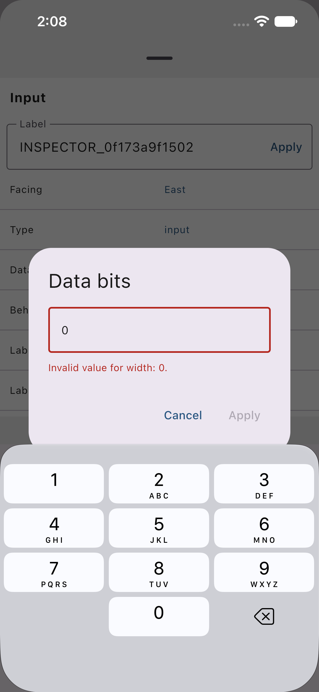

# Phone005 Inspector width scenario

One selected Inspector case passed on the Phone21 iPhone 17e Simulator, iOS 27.0. The method took 173.818 seconds with zero failures; wrapper session `50019` exited 0. The original results remain `PASS` and `NATIVE_PASS`, with whole-suite qualification **PARTIAL**. This is not a physical-device or global issue-closure result.

The app source is `6cef05429cf66be23569aaebc3c72950cf3fe53a`. The related validation commit is `85da031e4ed11474c2e763976392729810ef142d`; the unchanged app artifact manifest has SHA-256 `6006751321c48752f5676ddaba3b6ae20cbc7f10f43f60a5000c855a1e34ac17`. Those identify different objects from the test log and attachment manifest. The selected harness source is commit `1b5f5e424a4dd7c28fbdfbc37567d7d3b952c11c`.

The app bundle-tree SHA-256 is `d987d43d6587c0139ff0ecddca2d4ae95c9bad66ba6cd19d29c6452214be3080`. The executable SHA-256 is `198a06dc847cc0fd8717b7c05b06f334b8a1e701aaf63aed5a6012699be5b946`. The preserved independent postflight records the same installed identities after the run. Receipt verification compares these archived observations; it does not access live binaries.

The selected method is `InspectorEndToEndTests.testInvalidWidthPreservesProjectAndValidWidthIsOneUndoAction`. It imports the staged Inspector fixture through Files Import Copy. The staged input fingerprint, complete `Run.json`, compiled test source and original results are archived without annotation.

## Preserved observations

All four complete UI XML exports contain 481 bytes. Baseline, cancellation and one Undo are byte-for-byte identical, SHA-256 `2d0c873e42b8a636a73aec2859a069a036983ae33420de501f36cb82b4b1bc71`. The valid width-4 export has SHA-256 `047088d76cb36f19f98ebc8d277f25e3b0cc6046021603f33ad57454ac44cfcb`. Its only byte difference is `1` to `4` at offset 387 in the width attribute. The entire XML tree also matches after that one attribute change, including all other attributes, text and tails.

The invalid-state image shows input `0`, the specific width error, a disabled Apply action and the real numeric software keyboard. The matching native tree records `Invalid value for width: 0.` and the disabled Apply button.

Six field-root diagnostic captures record keyboard focus during `1 → empty → 0` and `1 → empty → 4`. The two empty captures omit the `value` attribute. Exact empty String was asserted by the running test, rather than printed explicitly in those dumps. The root focus marker is an SDK-dependent diagnostic, not a supported public focus API.

The log records two software-key Delete taps, one for each private single-digit transition. The preserved API-control captures place each Delete frame inside the observed keyboard. These facts do not qualify Select All, Cmd+A, multiselection or shared editing helpers.

Invalid Apply occupies `(267.33, 482.33, 63.67, 48)` and ends 11.67 points above `inputView` at y=542. Valid Apply starts at y=468.33 and ends 25.67 points above it. Both recorded visible frames equal their full frames. Geometry alone does not prove enabled state or hittability; those are separate runtime assertions, with invalid disabled state also recorded in the native tree.

## Offline receipt verification

The [receipt](ios-inspector-phone005-pass.json) and [raw-file manifest](artifacts/ios-inspector-phone005-pass/manifest.json) identify 25 preserved raw files, approximately 431 KB. They include the original results, Run, staged input, four XML exports, image and tree, six field roots, two Delete controls, two Apply geometries, test source, full test log, attachment manifest, observation and independent postflight. No xcresult bundle or binary is copied.

Run `python3 docs/validation/artifacts/ios-inspector-phone005-pass/verify.py` from the repository root. It rechecks hashes, selected-case status, staged identity, complete XML preservation and width-only change, root diagnostics, geometry and the two logged Delete actions. It makes no device call and reports the native rerun as `NOT_RUN`.

Phone001 through Phone004 remain separate failed evidence. This pass does not replace their receipts or establish the cause of their failures. Receipt preparation changed no product source, app, Simulator, cache or device state.
